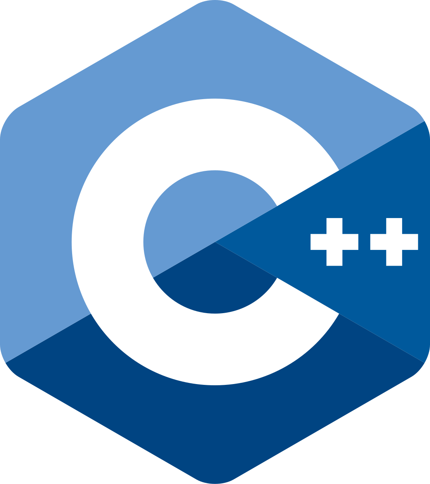
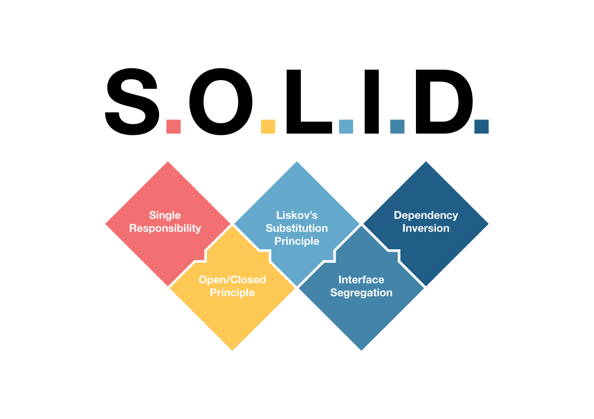

 

# C++ Modules

This repository contains solutions for the 42 school C++ modules (Cpp00 - Cpp09). And links to the Notion notes that cover the concepts used in each module.

# 🚀 Getting started

Each exercise contains a Makefile. To compile an exercise:

```bash
cd CppXX/exXX
make
```

### Makefile targets

```
make | make all    - Compile the program
make clean        - Remove object files
make fclean       - Remove object files and executable
make re           - Recompile everything
make debug        - Clean rebuild with debug flags (address sanitizer)
```

### Requirements

```
C++ compiler (c++)
C++98 standard
Make
```

## 🧭 Before you start

Links to C++ and OOP pages: the basics to start, plus extra notes on I/O and design.

### C++ and OOP basics

- [Differences between C++ and C](https://broken-snowdrop-f03.notion.site/Diferencias-entre-C-y-C-2a0b80eb3d888065afa1ca4a2f0b6563)
- [What C++ is and how the compilation process works](https://broken-snowdrop-f03.notion.site/Que-es-C-y-como-es-el-proceso-de-compilacion-29ab80eb3d8880fe95efd2f5db507f42)
- [What a class and an object are](https://broken-snowdrop-f03.notion.site/Que-es-una-clase-y-un-objeto-2a0b80eb3d888022a698f865e3395c9d)
- [Compilation in C++](https://broken-snowdrop-f03.notion.site/Compilacion-de-C-3f2b80eb3d8880368f9ee70369ecb4b9)
- [Organizing .hpp, .cpp and headers](https://broken-snowdrop-f03.notion.site/Organizacion-de-hpp-cpp-y-headers-2a0b80eb3d8880338152e9655846a85c)
- [Main headers of the C++ standard library](https://broken-snowdrop-f03.notion.site/Principales-header-de-la-biblioteca-estandar-en-C-2b0b80eb3d8880c69eacde48636c69e6)

### How the I/O classes, file handling and streams work

- [Cheat sheet for using I/O streams](https://broken-snowdrop-f03.notion.site/Cheat-sheet-de-I-O-streams-uso-3f8b80eb3d88808e98b9dce8f9757ddc)
- [Cheat sheet for file handling with fstream](https://broken-snowdrop-f03.notion.site/Cheat-sheet-de-manejo-de-archivos-con-fstream-3f8b80eb3d888072aed3c008ff1772fc)
- [Internal workings of the I/O classes](https://broken-snowdrop-f03.notion.site/Funcionamiento-interno-de-las-clases-de-I-O-3f8b80eb3d8880c193dbd1a4316a6b13)
- [std::ostream class](https://broken-snowdrop-f03.notion.site/Clase-std-ostream-3f8b80eb3d888007a671c2ff87f7d28b)
- [std::cerr class](https://broken-snowdrop-f03.notion.site/Clase-std-cerr-3f8b80eb3d8880f684b2d921e3bbdda2)
- [std::istream class](https://broken-snowdrop-f03.notion.site/Clase-std-istream-3f8b80eb3d8880f3b165e9132cd8e961)
- [File handling with fstream](https://broken-snowdrop-f03.notion.site/Manejo-de-archivos-con-fstream-3f8b80eb3d8880a48842d98298b2dd03)
- [getline function and reading file descriptors](https://broken-snowdrop-f03.notion.site/Funcion-getline-y-lectura-de-fds-3f8b80eb3d8880429846cc5a5ec12bd1)
- [How the stringstream class works](https://broken-snowdrop-f03.notion.site/Funcionmientos-de-la-clase-stringstream-3f8b80eb3d8880e5a00cef7c9d584488)
- [How the string class works](https://broken-snowdrop-f03.notion.site/Funcionamiento-de-la-clase-string-2b0b80eb3d888082a5bae1213c9801ae)

### OOP design principles

- [Basic programming principles](https://broken-snowdrop-f03.notion.site/Principios-basicos-de-la-programacion-3f8b80eb3d8880ccaed4f5817dcc6e3d)
- [Basic OOP design principles](https://broken-snowdrop-f03.notion.site/Principios-de-diseno-basicos-de-POO-3f8b80eb3d88802ca40ffedcde97e2d8)
- [SOLID principles](https://broken-snowdrop-f03.notion.site/Principios-solid-3f8b80eb3d8880419c86f2633e9cf49e)
- [Principles for building and scaling programs](https://broken-snowdrop-f03.notion.site/Principios-de-construccion-y-escalado-de-programas-3f8b80eb3d88806a8139dd8c50e17a3b)

## 🎯 MODULES

Each module contains its exercises and links to the Notion pages with the concepts you need to know for that module, plus extra concepts.

## Cpp00 & Cpp01

**OOP and C++ basics**

### Exercises

| Exercise | Description |
| --- | --- |
| [Cpp00.ex00](Cpp00/ex00/) | A simple program to convert text to uppercase |
| [Cpp00.ex01](Cpp00/ex01/) | A simple phonebook application |
| [Cpp00.ex02](Cpp00/ex02/) | Recreate the Account class implementation from the given header and tests |
| [Cpp01.ex00](Cpp01/ex00/) | Zombie class implementation |
| [Cpp01.ex01](Cpp01/ex01/) | Zombie horde |
| [Cpp01.ex02](Cpp01/ex02/) | References and pointers |
| [Cpp01.ex03](Cpp01/ex03/) | Weapon class with references |
| [Cpp01.ex04](Cpp01/ex04/) | File manipulation |
| [Cpp01.ex05](Cpp01/ex05/) | Pointers to member functions |
| [Cpp01.ex06](Cpp01/ex06/) | Switch statement |

### Concepts

- [Public and private class members. Encapsulation principle](https://broken-snowdrop-f03.notion.site/Miembros-de-una-clase-publicos-y-privados-Principio-de-encapsulacion-2a0b80eb3d88807caf4cd464eec6f87e)
- [Ways to initialize an object: default values, garbage values, constructors and constructor types](https://broken-snowdrop-f03.notion.site/Formas-de-inicializar-un-objeto-valores-por-defecto-valores-basura-y-contructores-y-tipos-de-const-2a0b80eb3d8880aeb5fdfef85ac5c406)
- [Ways to instantiate a class and create an object](https://broken-snowdrop-f03.notion.site/Formas-de-instanciar-una-clase-crear-un-objeto-2a0b80eb3d8880ef8816ccab3801bd85)
- [Pointers in C++ and dynamic memory allocation](https://broken-snowdrop-f03.notion.site/Punteros-en-C-y-reservas-de-memoria-dinamica-2a0b80eb3d8880229d9bff90660b5a0e)
- [What a destructor is in C++](https://broken-snowdrop-f03.notion.site/Que-es-un-destrcutor-en-c-2a0b80eb3d8880918d0dd111063ea2e7)
- [How references work in C++](https://broken-snowdrop-f03.notion.site/Como-funcionan-las-referencias-en-C-2a0b80eb3d88807687c4c4d3f074973c)
- [How const works in C++](https://broken-snowdrop-f03.notion.site/Como-funciona-const-en-C-2a0b80eb3d8880a49ecff2fac369e7a2)
- [What initialization lists are](https://broken-snowdrop-f03.notion.site/Que-son-las-listas-de-inicilizacion-2a0b80eb3d8880b9aca5d56f0ae71709)
- [Static variables, class members and objects](https://broken-snowdrop-f03.notion.site/Variables-mienbros-de-clase-y-objetos-static-2a0b80eb3d8880a8a25efb02dbeefd5e)
- [Namespaces](https://broken-snowdrop-f03.notion.site/Namespaces-2a0b80eb3d888032af6aed1ee32cfe03)
- [Scope resolution operator ::](https://broken-snowdrop-f03.notion.site/Operador-de-resolucion-de-ambito-2a0b80eb3d8880e49197f0bce856d7d2)
- [What the this clause is and what it is used for](https://broken-snowdrop-f03.notion.site/Que-es-la-clasusula-this-y-para-que-se-usa-2a0b80eb3d8880419ce1f256ff52e94c)
- [What methods can do](https://broken-snowdrop-f03.notion.site/Que-pueden-hacer-los-metodos-2a0b80eb3d88807d9b49d7d7eb8bd447)
- [Ways to use the for loop](https://broken-snowdrop-f03.notion.site/Maneras-de-usar-el-bucle-For-29ab80eb3d888091bb37f815513da322)
- [Creating an array of objects in local memory in C++](https://broken-snowdrop-f03.notion.site/Creacion-de-array-de-objetos-en-memoria-local-en-C-2b0b80eb3d888071acc5f26311fadf4c)
- [Cpp00 - BONUS](https://broken-snowdrop-f03.notion.site/Cpp00-BONUS-2afb80eb3d888014b80dfbb3c5094f45)
- [Pointers to functions and member functions in C++](https://broken-snowdrop-f03.notion.site/Punteros-a-funciones-y-a-metodos-en-C-2b4b80eb3d88805fa113d76b2dd72904)
- [Switch](https://broken-snowdrop-f03.notion.site/Switch-2b4b80eb3d888018a46ff82cce3a3c4c)

## Cpp02

**Operator overloading, static (ad-hoc) polymorphism and Orthodox Canonical classes**

### Exercises

| Exercise | Description |
| --- | --- |
| [ex00](Cpp02/ex00/) | A first class in Orthodox Canonical Form |
| [ex01](Cpp02/ex01/) | A more useful fixed-point number class |
| [ex02](Cpp02/ex02/) | Operator overloading |

### Concepts

- [General information about overloaded operators](https://broken-snowdrop-f03.notion.site/Inormacion-general-de-los-opradores-de-sobrecarga-2b5b80eb3d88808e83a0ffb48bb3a6d6)
- [Redirection operators to std::out](https://broken-snowdrop-f03.notion.site/Operadores-de-redireccion-a-la-std-out-2b5b80eb3d888057a772f81342ce04b7)
- [Static ad-hoc polymorphism between overloaded operators and functions with different arguments inside a class (compile time)](https://broken-snowdrop-f03.notion.site/Polimorfismo-add-hoc-estatico-entre-operadores-de-sobrecarga-y-funciones-con-distintos-argumento-den-2b5b80eb3d8880d0b219e0f58deabf74)
- [Assignment operators vs bitwise shallow copy](https://broken-snowdrop-f03.notion.site/Operadores-de-igualacion-vs-shallow-copy-bit-a-bit-2b5b80eb3d8880aab2e2ce885e5001ef)
- [Post-increment and pre-increment operators (the odd case where you must help the compiler)](https://broken-snowdrop-f03.notion.site/Operador-de-post-incrementos-y-preincremento-caso-raro-donde-hay-que-ayudar-al-compilador-2b5b80eb3d88805b96d1d41896c6200e)
- [Overloaded operators for arithmetic operations (returning references vs returning objects)](https://broken-snowdrop-f03.notion.site/Operadores-de-sobrecarga-para-operaciones-aritmeticas-devolver-referencias-vs-devover-objetos-2b5b80eb3d8880b6971ce63983049582)
- [Ad-hoc polymorphism between overloaded operators and functions with different arguments inside a class (compile time), part 2](https://broken-snowdrop-f03.notion.site/Polimorfismo-add-hoc-entre-operadores-de-sobrecarga-y-funciones-con-distintos-argumento-dentro-de-un-2b5b80eb3d888033a62efb5f59e6f4a0)
- [Orthodox canonical form](https://broken-snowdrop-f03.notion.site/ortodox-canonical-form-2b5b80eb3d8880eba31ad211dbfdfe04)
- [Using fixed-point numbers](https://broken-snowdrop-f03.notion.site/Uso-de-los-fixed-point-2b0b80eb3d888058a64df37d47232bde)
- [Math class](https://broken-snowdrop-f03.notion.site/Clase-math-2adb80eb3d88801ba5e2d8ed4d0de833)
- [Trick: a function that returns a memory address (reference or pointer) based on a condition and modifies it → moving to pointers and references](https://broken-snowdrop-f03.notion.site/truco-de-funcion-que-devulva-una-direccion-de-memeria-referncia-o-puntero-segun-una-condicion-y-mo-2b6b80eb3d8880a6a968e0c64226428d)

## Cpp03 & Cpp04

**Inheritance, dynamic polymorphism**

### Exercises

| Exercise | Description |
| --- | --- |
| [Cpp03.ex00](Cpp03/ex00/) | ClapTrap class |
| [Cpp03.ex01](Cpp03/ex01/) | ScavTrap derived class |
| [Cpp03.ex02](Cpp03/ex02/) | FragTrap derived class |
| [Cpp03.ex03](Cpp03/ex03/) | DiamondTrap (multiple inheritance) |
| [Cpp04.ex00](Cpp04/ex00/) | Animal, Dog, Cat classes with virtual functions |
| [Cpp04.ex01](Cpp04/ex01/) | Adding Brain class for deep copy |
| [Cpp04.ex02](Cpp04/ex02/) | Animal as an abstract class with pure virtual function |
| [Cpp04.ex03](Cpp04/ex03/) | Materia system with interfaces (AMateria, ICharacter, IMateriaSource) |

### Concepts

- [What inheritance is and the types of inheritance](https://broken-snowdrop-f03.notion.site/Que-es-la-herencia-y-que-tipos-de-herencia-hay-2bbb80eb3d88805591cbc5174f95834b)
- [What dynamic dispatch and dynamic polymorphism are](https://broken-snowdrop-f03.notion.site/Que-es-el-dinamic-dispach-y-el-polimorfismo-dinamico-2bbb80eb3d88808a8b8ff9c3501e2797)
- [At the memory level, why using a base-class reference/pointer to a derived object lets us access shared methods](https://broken-snowdrop-f03.notion.site/A-nivel-de-memeria-porque-cuando-usamos-referencias-o-puntero-de-la-clase-base-para-referirno-s-a-u-2bcb80eb3d888008924cfe59e7bc72df)
- [Uses of dynamic polymorphism, object slicing and a comparison of both](https://broken-snowdrop-f03.notion.site/Usos-del-polimorfismo-din-mico-object-slicing-y-comparaci-n-de-ambos-2bbb80eb3d8880f0990dd4a1829d7a29)
- [Inheritance, specialization and composition for scaling programs](https://broken-snowdrop-f03.notion.site/Herencia-especializacion-y-composion-escalado-de-programas-2bbb80eb3d888095a074eacb39ea679f)
- [Attribute hiding and getters with polymorphism](https://broken-snowdrop-f03.notion.site/Ocultamiento-de-atributos-y-getters-con-polimorfismo-2bcb80eb3d8880d1b0f2d2957e19ff2f)
- [Accessing base-class members from derived classes](https://broken-snowdrop-f03.notion.site/Acceso-a-mienbros-de-la-clase-base-des-de-la-heredadas-3f3b80eb3d88807cb185dfd585271b5c)
- [Diamond classes](https://broken-snowdrop-f03.notion.site/Clases-diamante-2bbb80eb3d8880b49e74e2328e4d6adc)
- [Shallow copy vs deep copy](https://broken-snowdrop-f03.notion.site/Shallow-copy-vs-deep-copy-2bcb80eb3d88804e9fc8ef2f4c50e465)
- [What abstract classes and interfaces are](https://broken-snowdrop-f03.notion.site/Que-son-las-clases-abstractas-y-las-interfaces-2a0b80eb3d88805d8b4be006427d572b)
- [Declaring an array of references to objects → impossible](https://broken-snowdrop-f03.notion.site/Declaracion-dearray-de-referencias-a-objetos-imposible-2bcb80eb3d888088ad4ede71cf73db5e)
- [Passing an array of objects as a parameter](https://broken-snowdrop-f03.notion.site/Pasa-un-array-de-ibjetos-por-un-parametro-2bcb80eb3d88800d9f31e8d0431b14dc)
- [Returning an array of something from a function (getter example)](https://broken-snowdrop-f03.notion.site/Devolver-en-un-afuncion-un-array-de-algo-ejemplo-de-getter-2bcb80eb3d888087ae11d7eedfc6e254)
- [What happens with extra const → they cannot be declared](https://broken-snowdrop-f03.notion.site/Que-pasa-conn-clos-extra-que-no-se-pueden-declarar-2bcb80eb3d8880d495c7da64272cf987)
- [std::copy, std::fill and the <algorithm> library](https://broken-snowdrop-f03.notion.site/Std-copy-y-std-fill-y-libreria-algorith-2a1b80eb3d88802daf7ed82cd1a7fbb5)

## Cpp05

**Exceptions, nested classes and advanced handling**

### Exercises

| Exercise | Description |
| --- | --- |
| [ex00](Cpp05/ex00/) | Implementation of a Bureaucrat class with grade validation and exception handling |
| [ex01](Cpp05/ex01/) | Adding a Form class that interacts with the Bureaucrat class, including signing functionality |
| [ex02](Cpp05/ex02/) | Introduction of abstract forms (AForm) and specific form types like PresidentialPardonForm, RobotomyRequestForm, and ShrubberyCreationForm |
| [ex03](Cpp05/ex03/) | Implementation of an Intern class that can create forms dynamically based on input |

### Concepts

- [How exceptions work in C++ (try, throw and catch)](https://broken-snowdrop-f03.notion.site/Como-fucnionan-las-excepciones-en-C-try-throw-y-catch-30fb80eb3d888086be7df5506770813f)
- [Stack unwinding and std::terminate when exceptions are not caught](https://broken-snowdrop-f03.notion.site/Stack-unwinding-y-std-terminate-por-no-recoger-excepciones-3f3b80eb3d8880d48f14cab500bfd08c)
- [Memory scope of the try block and dynamic memory with try/catch](https://broken-snowdrop-f03.notion.site/Ambito-de-memoria-del-bloque-try-y-memeria-dinamica-con-try-t-catch-3f3b80eb3d888060b5e4e62c6ab2c7a8)
- [std::exception, classes that inherit from it, and how to create custom error classes](https://broken-snowdrop-f03.notion.site/Std-exception-clases-que-heredan-de-ella-y-clases-de-error-personalizadas-crear-3f3b80eb3d888075b401d40ad454fd6d)
- [Nested classes and how they differ from composition](https://broken-snowdrop-f03.notion.site/Clases-anidadas-y-diferencia-con-composicion-3f3b80eb3d8880e39cf5d216dac4952c)
- [Nested classes and inheritance (not inherited by subclasses)](https://broken-snowdrop-f03.notion.site/Clases-anidadas-y-herencia-no-se-heredan-por-las-clases-subbase-3f3b80eb3d88807597ade587732cf6d8)
- [Why nest custom exceptions inside the classes we create errors for](https://broken-snowdrop-f03.notion.site/Porque-anidar-las-excepciones-personalizadas-dentro-de-las-clases-para-las-que-creamos-errores-3f3b80eb3d88807c8ddfe8584d79b863)
- [Fallback and nested exceptions](https://broken-snowdrop-f03.notion.site/Excepciones-en-fallback-y-anidadas-3f3b80eb3d8880b29394c5b0fb891150)

## Cpp06

**Casts, conversions between strings/chars and numeric types, between numeric types and strings/chars, base and format conversions, math library functions, limit handling, etc…**

### Exercises

| Exercise | Description |
| --- | --- |
| [ex00](Cpp06/ex00/) | Using std::strtod and static_cast for type conversion |
| [ex01](Cpp06/ex01/) | Using reinterpret_cast for pointer manipulation |
| [ex02](Cpp06/ex02/) | Checking pointers in polymorphic class hierarchies |

### Concepts

- [Type conversions and casts in C++](https://broken-snowdrop-f03.notion.site/Conversiones-de-tipos-y-casteos-en-C-312b80eb3d8880129cf3fcf00fa00c36)
- [Functions to tell what type of data something is <ctype>](https://broken-snowdrop-f03.notion.site/Funciones-para-saber-que-tipo-de-dato-es-algo-ctype-3f3b80eb3d8880a2a6f3dd6b1587a613)
- [Functions for numeric type limits <cfloat> and <climits>](https://broken-snowdrop-f03.notion.site/Funciones-para-limites-de-tipo-numericos-cfloat-y-climits-3f3b80eb3d88805bb6cee68650c5c0d3)
- [Functions for detecting infinities and NaN and math utilities <cmath>](https://broken-snowdrop-f03.notion.site/Funciones-para-deteccion-de-infinitos-y-nan-y-cosas-de-matematicas-cmath-3f3b80eb3d8880d0ac66f09edb9e34d8)
- [Converting strings to numbers without streams and choosing a base <cstdlib>](https://broken-snowdrop-f03.notion.site/Cambios-de-strings-a-numeros-sin-streams-y-elecccion-base-cstdlib-3f3b80eb3d8880bb90e9c0104a53c92c)
- [Converting numeric variables to strings and char in C++](https://broken-snowdrop-f03.notion.site/Cambios-de-variables-numericas-a-strings-y-ch-en-C-3f4b80eb3d888090b985c9b609b3eb44)
- [Time functions in C++ <ctime>](https://broken-snowdrop-f03.notion.site/Funciones-de-Tiempo-en-C-ctime-3f3b80eb3d88808ca09ff55f006272f2)
- [Functions to generate random numbers + the concept of a seed](https://broken-snowdrop-f03.notion.site/Funciones-para-generar-numeros-random-concepto-de-semilla-3f3b80eb3d8880c29484da90ca0343ba)
- [Serialization and deserialization (standardization across systems)](https://broken-snowdrop-f03.notion.site/Serializacion-y-deserializacion-estandarizacion-entre-distintos-sistemas-312b80eb3d8880209639cf3af7f91e8b)
- [Portability of uintptr_t across processor architectures and use cases](https://broken-snowdrop-f03.notion.site/Portabilidad-de-unit_ptr-entre-diferentes-aquitecturas-de-procesador-y-casos-de-uso-312b80eb3d88805fb917e6f7cb0931d9)

## Cpp07

**Templates, template data types, function templates, structs and classes. Understanding how high-level containers work**

### Exercises

| Exercise | Description |
| --- | --- |
| [ex00](Cpp07/ex00/) | Creating functions using templates for generic data types, pointers, and references |
| [ex01](Cpp07/ex01/) | Implementing a template function that accepts generic types, including const and non-const pointers |
| [ex02](Cpp07/ex02/) | Creating a template-based array class with const and non-const instantiations, overloaded operators, and exception handling |

### Concepts

- [What templates are](https://broken-snowdrop-f03.notion.site/Que-son-los-templates-3f5b80eb3d888006a540cdfdb9472786)
- [Function templates and template data types in C++](https://broken-snowdrop-f03.notion.site/Templates-para-funciones-y-tipos-de-datos-template-en-C-3f4b80eb3d8880aa8fbcfa639aca2ceb)
- [Case: iterating arrays from template functions](https://broken-snowdrop-f03.notion.site/Caso-de-recorrer-arrays-desde-fucnciones-template-3f4b80eb3d8880a4bd0eee1ed54acb6f)
- [Data packages (template structs and classes)](https://broken-snowdrop-f03.notion.site/Paquetes-de-datos-structs-y-clases-template-3f5b80eb3d8880c38e0ee2ef04a86c60)
- [Notation to return template-class objects from functions](https://broken-snowdrop-f03.notion.site/Notacion-para-devolver-objetos-de-clase-template-desde-funciones-3f5b80eb3d88807cac8adcb072512dae)
- [Creating arrays of template data](https://broken-snowdrop-f03.notion.site/Crear-arrays-de-datos-template-3f5b80eb3d88801aa03acda4875cd7e1)
- [Combining class templates with arrays/structs to build your own high-level containers in C++ and overloading the [] access operator](https://broken-snowdrop-f03.notion.site/Combinar-templates-de-clases-y-arrays-strcuts-para-crear-nuestros-propios-contenedores-de-alto-nivel-3f5b80eb3d88803484c3c472ea64b95f)

## Cpp08 & Cpp09

**C++ containers, iterators, advanced container usage (efficiency), std algorithms and iterator best practices. Using containers to solve complex problems: information processing, lexical analysis and token creation with stringstreams**

### Exercises

| Exercise | Description |
| --- | --- |
| [Cpp08.ex00](Cpp08/ex00/) | Function template to find a value in any non-associative container using its iterator (tested with all standard containers: construction, method, iteration) |
| [Cpp08.ex01](Cpp08/ex01/) | Class with an internal container, limited size, methods to add elements, equality operators, and algorithms to find the shortest and longest span (difference) between elements. Includes automatic data generation. |
| [Cpp08.ex02](Cpp08/ex02/) | Class inheriting from stack, specialized with an internal instantiable iterator, supporting increment, decrement, equality, comparison, dereference operators, and canonical constructors. |
| [Cpp09.ex00](Cpp09/ex00/) | Parsing input data and computing exchange rates |
| [Cpp09.ex01](Cpp09/ex01/) | Reverse Polish Notation evaluator using a stack |
| [Cpp09.ex02](Cpp09/ex02/) | Merge-insert sort on std::vector and std::deque |

### Concepts

- [Containers](https://broken-snowdrop-f03.notion.site/Containers-3f5b80eb3d888025ab1cdf7d7a85c0ba)
- [Iterators: internal workings](https://broken-snowdrop-f03.notion.site/Iteradores-funcionamiento-interno-3f5b80eb3d88806b9e6df5608eabea55)
- [Using typename for nested types in templates](https://broken-snowdrop-f03.notion.site/Uso-de-typename-para-tipos-anidados-en-templates-3f5b80eb3d88806ea624dc7e1354d432)
- [Sequential containers: vector, deque and lists](https://broken-snowdrop-f03.notion.site/Containers-secuenciales-vect-y-deque-y-lists-3f7b80eb3d8880faaef8c06974da40cc)
- [Associative containers: sets and multisets, pairs and maps](https://broken-snowdrop-f03.notion.site/Containers-asociativos-sets-y-multisets-pairs-y-maps-3f7b80eb3d888081a581f50b188deeea)
- [Unordered associative containers](https://broken-snowdrop-f03.notion.site/Containers-asociativos-unordered-3f7b80eb3d8880f9aa81e3534d6040f8)
- [Using inheritance and composition to limit access to a class's attributes](https://broken-snowdrop-f03.notion.site/Usos-de-la-herencia-y-la-composicion-para-limitar-el-acceso-a-atributos-de-una-clase-3f7b80eb3d88800b9ad9e7d5a8de0e22)
- [Container adaptors](https://broken-snowdrop-f03.notion.site/Adaptadores-de-containerse-3f5b80eb3d8880369aa8d191f8ac242c)
- [Algorithms](https://broken-snowdrop-f03.notion.site/Algoritmos-3f5b80eb3d88809db5aee35bb45e8992)
- [Containers of C++: table of containers, uses and prototypes](https://broken-snowdrop-f03.notion.site/Containers-de-C-Tabla-de-containers-usos-y-prototipo-3f7b80eb3d8880c592e8e3fa7340976d)
- [stringstream class](https://broken-snowdrop-f03.notion.site/Clase-stringstream-2b0b80eb3d888029bb1edc242df268ae)
- [std::containers and iterators](https://broken-snowdrop-f03.notion.site/STD-CONTAINERS-e-iteradores-315b80eb3d88802e8861f05bd93c781a)
- [Iterators: specifics, usage mistakes and best practices](https://broken-snowdrop-f03.notion.site/Iteradores-cosas-especificas-errores-de-uso-y-buenas-practicas-315b80eb3d8880d6b98be04825f8db25)
- [insert and push vs emplace](https://broken-snowdrop-f03.notion.site/Intert-y-push-vs-emplace-340b80eb3d8880c59d51c813f0193e38)
- [Iterators invalidated by changes to containers built on linear arrays](https://broken-snowdrop-f03.notion.site/Iteradores-invalidados-por-cambios-en-contendores-hechos-sobre-arrays-lineales-340b80eb3d88802783c4c2cb19d068b1)
- [Unordered map O(1)](https://broken-snowdrop-f03.notion.site/Unordered-map-O-1-340b80eb3d88805c9b77f2f11d687522)
- [The importance of a container's memory footprint depending on its internal data structures](https://broken-snowdrop-f03.notion.site/Importancia-del-peso-de-los-contenedores-en-memoria-segun-las-Ds-que-usen-internamente-340b80eb3d8880f6965aeef9e2f1c18a)
- [Production (list and map < vector and unordered_map)](https://broken-snowdrop-f03.notion.site/Produccion-list-y-map-vector-y-unorderedmap-340b80eb3d8880c2a34ec01901b39042)
- [Common interview mistakes](https://broken-snowdrop-f03.notion.site/Errores-comunes-en-entrevistas-340b80eb3d8880f7a7fddb3c059f0ba0)

## 📚 Resources

- https://en.cppreference.com/
- https://cplusplus.com/
- https://isocpp.github.io/CppCoreGuidelines/CppCoreGuidelines


## Author 👨‍💻

alcarril - https://github.com/alcarril
